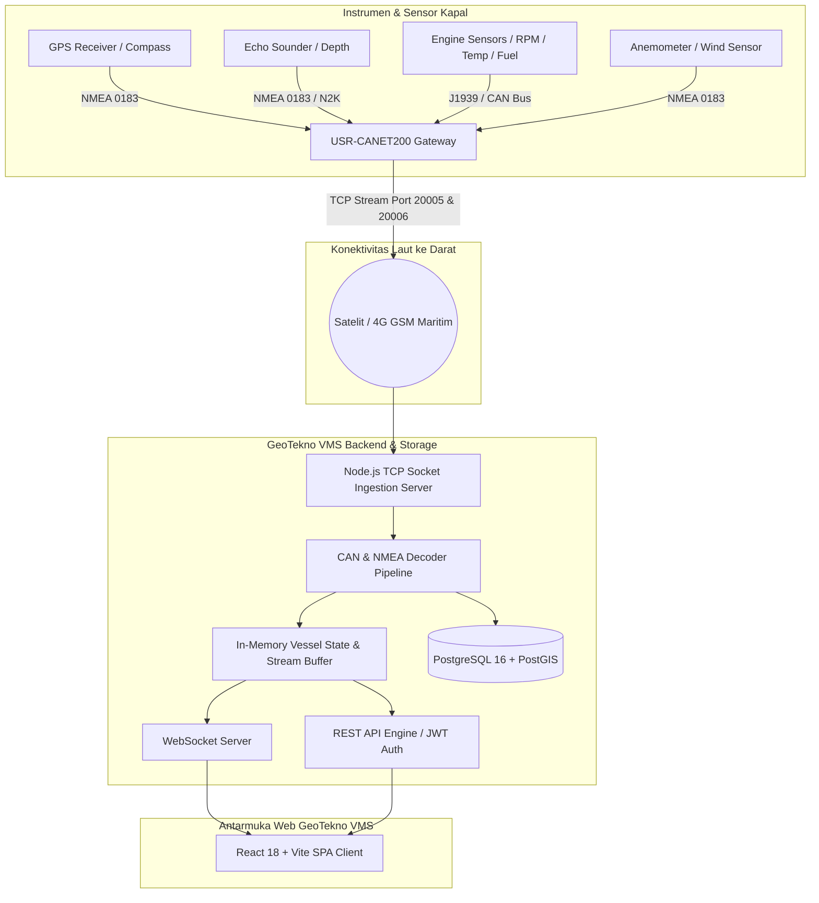

# GeoTekno VMS (Vessel Monitoring System)

<div align="center">


### **Platform Terpadu Pemantauan Armada Kapal, IoT Navigasi Maritim & Digital Twin Telemetri Real-Time**

[](https://www.docker.com/)
[](https://reactjs.org/)
[](https://nodejs.org/)
[](https://postgis.net/)
[](https://tailwindcss.com/)
[]()

</div>

---

## 📌 Ringkasan Proyek

**GeoTekno VMS** adalah platform operasional armada maritim (*fleet management & vessel monitoring*) generasi terbaru yang dirancang untuk memproses, memvisualisasikan, dan menganalisis data telemetri kapal secara *real-time*.

Platform ini terhubung langsung dengan perangkat keras gateway di kapal (**USR-CANET200** dan modul **RS-485 / Serial Edge**) yang menangkap sinyal instrumen navigasi dan mesin kapal berbasis protokol standar internasional:
- **NMEA 2000 (CAN Bus / ISO-TP / Fast-Packet)**
- **NMEA 0183 (Serial RS-422 / RS-485)**
- **Sensor Analog & Digital Mesin Kapal**

Platform menyediakan *dashboard digital twin* presisi tinggi, peta navigasi laut interaktif dengan data batimetri dan jalur pelayaran, terminal diagnostik paket data mentah, serta sistem ekspor riwayat telemetri untuk kebutuhan pelaporan dan audit operasional kapal.

---

## 🏗️ Arsitektur Sistem



---

## 🚀 Fitur-Fitur Utama Platform

### 1. 📊 Operations Overview (Command Center)
- **Ringkasan Operasional Utama**: Menampilkan metrik armada secara cepat (jumlah kapal aktif, kecepatan rata-rata armada, status gateway kapal, dan peringatan aktif).
- **Snapshot Peta Cepat**: Tinjauan posisi geografis seluruh kapal secara langsung pada peta satelit/nautika.
- **Kartu Telemetri Prioritas**: Widget ringkas status mesin, posisi koordinat GPS, heading kompas, kedalaman laut terkini, dan kecepatan kapal (SOG).
- **Status Konektivitas Real-Time**: Indikator status platform (*Platform Online*, koneksi TCP stream aktif, dan frame rate telemetri).

---

### 2. 🗺️ Live Marine Traffic (Peta Navigasi Laut Interaktif)
- **Peta Berbasis OpenMapTiles Marine Navigation**: Tampilan peta laut beresolusi tinggi dengan garis kontur kedalaman laut (*bathymetry*), alur pelayaran resmi (*shipping lanes/fairways*), zona terlarang, pelabuhan, dan rambu navigasi.
- **Pelacakan Posisi Kapal Sendiri (Own Ship Tracking)**:
  - Vektor arah haluan kapal (*Heading vector* & *Course Over Ground / COG*) yang akurat.
  - Penandaan kapal (*own ship icon*) dengan orientasi sudut derajat real-time.
  - Jejak riwayat lintasan pelayaran (*Voyage Breadcrumb Track*) dengan interpolasi titik waktu.
- **Monitoring Target AIS Regional**: Pemantauan kapal sekitar dengan pewarnaan kategori tipe kapal standar internasional (Cargo, Tanker, Passenger, Tug/Special, Fishing).
- **Tema Peta Kustom**: Pilihan gaya peta *Nautical S-57 / Bright*, *Dark Mode Tactical*, dan *Satellite View*.
- **Informasi Cuaca Laut**: Pemantauan arah dan kecepatan angin lokal di koordinat kapal.

---

### 3. 🚢 Vessel Assets Management (Manajemen Aset Kapal)
- **Registrasi & Direktori Kapal**: Inventarisasi lengkap armada kapal mencakup Nama Kapal, Nomor IMO, MMSI, Call Sign, dan Tipe Kapal.
- **Asosiasi Gateway Perangkat Keras**: Pemetaan aset kapal terhadap ID Agent TCP Gateway yang terpasang di fisik kapal.
- **Manajemen Sensor & Atribut**: Konfigurasi parameter sensor aktif untuk tiap kapal (RPM Mesin, Tekanan Oli, Suhu Pendingin, Kedalaman, Tegangan Aki, Bahan Bakar, dll.).
- **Pencarian & Penyaringan Cepat**: Filter berdasarkan status operasional (*Underway, In Port, Anchored, Maintenance*).

---

### 4. 📈 Monitoring (Digital Twin & Telemetry Widgets)
- **Desain Gauge & Indikator Presisi**:
  - **Depth Sounder Widget**: Visualisasi kedalaman air bawah lunas (*depth below transducer*) dengan palet warna air laut gradien dinamis dan indikator dasar laut.
  - **Analog & Digital Gauges**: Indikator tachometer RPM mesin, kecepatan kapal (SOG dalam knot), sudut kemudi (Rudder Angle), dan kompas haluan (*Compass Rose Heading*).
  - **Bar & Meter Status**: Pengukur tingkat bahan bakar (Fuel Tank), suhu oli mesin, tekanan pelumasan, dan tegangan aki sistem navigasi.
- **Kustomisasi Layout Dashboard**: Pengguna dapat mengatur urutan widget, mengubah ukuran grid, serta menyesuaikan indikator yang ditampilkan sesuai kebutuhan pengawasan operasional kapal.
- **Grafik Tren Telemetri**: Grafik garis riwayat real-time untuk mendeteksi fluktuasi anomali nilai sensor secara dini.

---

### 5. 📡 Live Logs (Terminal Diagnostik TCP Gateway)
- **Inspeksi Paket Data Mentah**: Menampilkan aliran frame data asli yang diterima dari port TCP hardware secara live tanpa modifikasi.
- **Multi-Protocol Decoder**:
  - **NMEA 2000 (CAN bus)**: Menampilkan raw CAN ID, byte payload (contoh: `18F11234 8 1A 4F 09 2D 10 00 7B C2`), PGN decoder (Engine, Depth, Position), dan status frame.
  - **NMEA 0183 (Serial)**: Menampilkan kalimat NMEA baku (seperti `$GPRMC`, `$GPGGA`, `$SDDBT`, `$VWMTW`, dll.) beserta status checksum.
- **Filter Diagnostik Tingkat Lanjut**: Filter berdasarkan nama kapal, ID agen gateway, decoder yang digunakan, level severity (*Info, Warning, Error*), dan pencarian kata kunci pada payload.
- **Payload Inspector Modal**: Klik detail paket untuk melihat hasil penguraian field data biner secara komprehensif.

---

### 6. 📥 Data Export (Ekspor Riwayat Telemetri)
- **Ekspor Berbasis Waktu**: Pemilihan rentang tanggal dan jam pengambilan data riwayat telemetri (*from date/time* hingga *to date/time*).
- **Atribut Terdaftar Dinamis**: Pilihan *Telemetry Attributes* menyesuaikan dengan sensor yang secara nyata terpasang dan terdaftar pada kapal yang dipilih.
- **Dukungan Format Standar**: Ekspor instan ke format **CSV** dan **JSON** untuk kebutuhan audit, analisis logistik bahan bakar, verifikasi rute, atau pelaporan regulator maritim.

---

### 7. 🔐 User Management & Role-Based Access Control (RBAC)
- **Sistem Peran Fleksibel**:
  - **Super Admin**: Akses penuh ke seluruh konfigurasi sistem, manajemen pengguna, pembuatan kapal/agen, dan kontrol hak akses.
  - **Fleet Operator**: Akses operasional untuk pemantauan, pengaturan widget, dan ekspor data.
  - **Viewer**: Hak akses hanya-baca (*read-only*) untuk monitoring tanpa izin mengubah konfigurasi.
- **Izin Akses Berbasis Halaman**: Pengaturan hak akses (*Create, Read, Update, Delete*) per halaman secara granular.
- **Keamanan JWT**: Otentikasi sesi terproteksi dengan JSON Web Token dan penyimpanan aman.

---

## ⚙️ Spesifikasi Protokol & Port Konektivitas

| Layanan / Protokol | Port Default | Deskripsi |
| :--- | :--- | :--- |
| **Frontend Web Console** | `3000` | Antarmuka web pengguna Nginx + React SPA |
| **Backend API & WebSocket** | `8080` | Endpoint REST API HTTP dan WebSocket stream server |
| **TCP Agent Gateway (Hybrid CAN/RS485)** | `20005` | Port penerimaan aliran TCP soket untuk USR-CANET200 (CAN & Serial) |
| **TCP Agent Gateway (RS-485 NMEA0183)** | `20006` | Port penerimaan aliran TCP soket untuk Serial Edge NMEA 0183 |
| **Database PostgreSQL + PostGIS** | `5432` | Penyimpanan persisten data spasial, akun, dan time-series |

---

## 🛠️ Panduan Instalasi & Menjalankan Sistem

### Prasyarat
- [Docker Engine](https://docs.docker.com/engine/install/) versi 24.0+
- [Docker Compose](https://docs.docker.com/compose/) v2+
- Git

### 1. Clone Repository
```bash
git clone https://github.com/delfin2492/geotekno-vms.git
cd geotekno-vms
```

### 2. Jalankan Seluruh Sistem dengan Docker Compose
Cukup jalankan satu perintah berikut di terminal:
```bash
docker compose up -d --build
```

Docker akan mengompilasi dan mengaktifkan 3 kontainer utama:
1. `nav_postgres`: PostgreSQL 16 dengan ekstensi spasial PostGIS.
2. `nav_backend`: Node.js API, parser biner telemetri, dan TCP Gateway listener.
3. `nav_frontend`: Nginx web server menyajikan React TypeScript build.

### 3. Akses Platform Web
Buka browser dan navigasikan ke:
```
http://localhost:3000
```

### Akun Bawaan (Default Credentials):
- **Username / Email**: `superadmin@geotekno.id` (atau ketik `superadmin`)
- **Password**: `AdminNav2026!`
- **Role**: `Super Admin`

---

## 📁 Struktur Direktori Repositori

```
geotekno-vms/
├── docker-compose.yml          # Konfigurasi orkestrasi container Docker
├── .gitignore                  # Filter berkas Git
├── README.md                   # Dokumentasi resmi proyek
│
├── backend/                    # Layanan Backend & TCP Gateway (Node.js)
│   ├── Dockerfile
│   ├── package.json
│   └── src/
│       ├── agents/             # Pengelola koneksi agen TCP & buffer log
│       ├── api/                # Router endpoint REST API & Auth
│       ├── assets/             # Manajemen data kapal & atribut sensor
│       ├── auth/               # Middleware JWT, repositori user & role
│       ├── config/             # Pengaturan environment & port
│       ├── db/                 # Koneksi pool PostgreSQL & migrasi SQL PostGIS
│       ├── logs/               # Circular buffer telemetri live
│       ├── network/            # TCP socket server (20005/20006) & WebSocket
│       ├── parser/             # CAN frame, Fast-Packet, ISO-TP & NMEA decoders
│       ├── state/              # In-memory vessel digital twin state
│       └── widgets/            # Pengelola preset tata letak widget
│
├── frontend/                   # Antarmuka Pengguna Web (React + Vite + TS)
│   ├── Dockerfile
│   ├── nginx.conf              # Konfigurasi reverse proxy Nginx untuk SPA
│   ├── package.json
│   ├── vite.config.ts
│   ├── public/                 # Aset statis & logo resmi GeoTekno
│   └── src/
│       ├── app/                # AppShell navbar, proteksi rute, & routing
│       ├── components/
│       │   ├── common/         # Komponen UI umum, modal, tabel, icon kapal
│       │   └── map/            # OpenMapTiles Marine nautical chart engine
│       ├── domain/             # Definisi TypeScript domain types
│       ├── pages/              # Halaman: Overview, Traffic, Monitoring, Assets, Logs, Export
│       ├── services/           # HTTP API client & WebSocket connector
│       └── state/              # AuthProvider & FleetProvider state management
│
└── doc/                        # Panduan teknis perangkat keras & manual navigasi
    ├── USR-CANET200-User-Manual_V1.0.4.01.pdf
    └── ECHOMAP_UHD2_Install_ID-ID.pdf
```

---

## 📄 Lisensi & Hak Cipta

© 2026 **GEOTEKNO** (PT Geo Tekno Indonesia). Hak Cipta Dilindungi Undang-Undang.  
Seluruh kode dan arsitektur sistem ini bersifat *proprietary* untuk solusi navigasi dan telemetri armada kapal.
