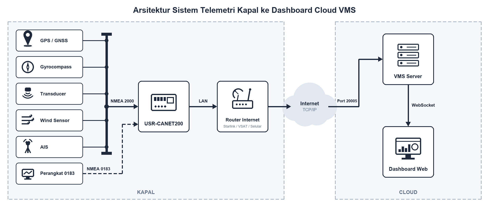

# GeoTekno VMS (Vessel Monitoring System)

<div align="center">


### **Platform Terpadu Pemantauan Armada Kapal, IoT Navigasi Maritim & Digital Twin Telemetri Real-Time**

[](https://www.docker.com/)
[]()
[](https://reactjs.org/)
[](https://nodejs.org/)
[](https://postgis.net/)
[](https://tailwindcss.com/)
[]()

</div>

---

## 📌 Ringkasan Proyek

**GeoTekno VMS** adalah platform operasional armada maritim (*fleet management & vessel monitoring*) generasi terbaru berskala **Multi-Tenant Enterprise** yang dirancang untuk memproses, memvisualisasikan, dan menganalisis data telemetri kapal secara *real-time*.

Platform ini mengadopsi arsitektur **Multi-Company Tenancy**, memungkinkan satu instalasi sistem cloud melayani berbagai perusahaan pelayaran, operator armada, atau instansi maritim yang berbeda (*multi-tenant*) dengan **isolasi data yang ketat**, kontrol hak akses berbasis peran granular, dan manajemen armada mandiri.

Platform terhubung langsung dengan perangkat keras gateway di atas kapal (**USR-CANET200** dan modul serial) yang menangkap sinyal instrumen navigasi, transduser bawah air, dan sensor cuaca maritim berbasis protokol standar internasional:
- **NMEA 2000 (CAN Bus 2.0B / SAE J1939 - 250 Kbps)**
- **NMEA 0183 (Serial RS-422 / RS-232 - 4800 / 38400 bps)**

Platform menyediakan *dashboard digital twin* presisi tinggi, peta navigasi laut interaktif dengan data batimetri dan alur pelayaran, terminal diagnostik paket data mentah, serta sistem ekspor riwayat telemetri untuk kebutuhan pelaporan operasional dan audit maritim.

---

## 🏗️ Topologi dan Arsitektur Aliran Data

Aliran data telemetri mengalir dari sensor kapal menuju server cloud melalui pipeline berlapis:

<div align="center">



*Gambar 1: Diagram Arsitektur Aliran Data Telemetri Maritim dari Sensor Kapal Menuju Dashboard Cloud VMS.*

</div>

### Alur Kerja Sistem (Data Pipeline):
1. **Instrumen & Sensor Kapal**:
   - **Backbone NMEA 2000 (CAN Bus)**: GPS Antenna, Gyrocompass, Transduser Sonar/Echosounder, dan Anemometer Wind Sensor memancarkan paket data biner 250 Kbps.
   - **Jalur NMEA 0183 (Serial)**: Perangkat display navigasi dan transponder AIS memancarkan kalimat teks ASCII standar.
2. **Gateway USR-CANET200 (Mode TCP Client)**:
   - Mengonversi frame CAN menjadi **Paket Biner Transparan 13-Byte**.
   - Bekerja sebagai *TCP Client* yang aktif membuka soket koneksi menuju alamat IP server VMS di cloud.
   - Mengirimkan string **Register Content (Identity Packet)** (misal: `"KM_Uno"`) sebagai identitas unik kapal saat pertama kali tersambung, serta paket **Heartbeat** berkala (30 detik).
3. **Router Internet Kapal (Starlink / VSAT / Seluler 4G)**:
   - Bertindak sebagai gerbang *uplink* telekomunikasi kapal ke darat. Menggunakan NAT dan IP privat lokal, mengeliminasi kebutuhan IP publik statis yang mahal pada kapal.
4. **Jaringan Internet TCP/IP**:
   - Paket data diteruskan melalui internet publik menuju server cloud pada port tujuan:
     - **Port 20005**: Aliran data biner NMEA 2000 (CAN).
     - **Port 20006**: Aliran kalimat teks ASCII NMEA 0183 (Serial).
5. **Backend Server Ingestion & Database Cloud**:
   - Node.js Ingestion Server memvalidasi identitas kapal (*asset binding*), membedah paket biner 13-byte / kalimat ASCII, dan menyimpan log telemetri ke basis data spasial **PostgreSQL 16 + PostGIS**.
6. **Web Dashboard Monitoring & Digital Twin**:
   - Data disiarkan seketika via **WebSocket** ke antarmuka web pengguna (*React 18 + Vite SPA*) untuk animasi widget instrumen 60 FPS dan visualisasi posisi kapal pada peta laut.

---

## 📚 Manual Perangkat Keras & Diagram Arsitektur (Folder `doc/`)

Repositori ini menyertakan dokumentasi manual resmi perangkat keras dan diagram arsitektur sistem maritim:

| File Dokumen | Format | Sasaran Pembaca | Deskripsi Isi Dokumen |
| :--- | :---: | :--- | :--- |
| **[`arsitektur_sistem_vms.png`](doc/arsitektur_sistem_vms.png)** | `.png` | Semua Stakeholder | **Diagram Arsitektur Sistem VMS**: Visual resmi alur telemetri dari NMEA 2000 / NMEA 0183, USR-CANET200, TCP Server Ingestion, PostgreSQL/TimescaleDB, hingga Frontend Web Map. |
| **[`ECHOMAP_UHD2_6_7_9xsv_(Touch)_Install_ID-ID.pdf`](doc/ECHOMAP_UHD2_6_7_9xsv_(Touch)_Install_ID-ID.pdf)** | `.pdf` | Teknisi Lapangan (*Field Tech*) | **Panduan Pemasangan Garmin ECHOMAP UHD2 Touch Series**: Petunjuk instalasi fisik display chartplotter, transducer, serta skema kabel NMEA 2000 & daya maritim (Bahasa Indonesia). |
| **[`USR-CANET200-User-Manual_V1.0.4.01.pdf`](doc/USR-CANET200-User-Manual_V1.0.4.01.pdf)** | `.pdf` | Teknisi & DevOps | **Manual Resmi USR-CANET200 Gateway**: Spesifikasi hardware converter CAN-to-Ethernet, pinout port CAN1/CAN2, konfigurasi Web GUI, mode TCP Client, dan parameter framing data CAN. |
| **[`tmp_189_2-16-2023_110828_.pdf`](doc/tmp_189_2-16-2023_110828_.pdf)** | `.pdf` | Engineering | **Dokumen Referensi Teknis Perangkat**: Lembar spesifikasi teknis dan panduan operasional pendukung hardware telemetri. |

---

## 📡 Kamus Telemetri yang Didukung (Navigasi, Transduser & Wind)

Platform VMS memproses parameter telemetri kapal secara terpadu melalui pemetaan setara antara PGN NMEA 2000 dan Kalimat NMEA 0183:

| Parameter Maritim | PGN NMEA 2000 | Kalimat NMEA 0183 | Formula Konversi / Scaling | Satuan Metrik Output |
| :--- | :---: | :---: | :--- | :--- |
| **Kedalaman Air (*Water Depth*)** | `128267` | `$SDDPT`, `$SDDBT` | `uint32 LE x 0.01` (Offset lunas kapal) | Meter (m) |
| **Suhu Air Laut (*Water Temp*)** | `130310` | `$SDMTW` | `(uint16 LE x 0.01) - 273.15` | Derajat Celsius (°C) |
| **Haluan Kompas (*Vessel Heading*)** | `127250` | `$HCHDT`, `$HCHDG` | `uint16 LE x 0.0001 x (180/π)` | Derajat ($0^\circ - 360^\circ$) |
| **Posisi Lintang & Bujur (GPS)** | `129025` | `$GPGLL`, `$GPRMC` | `int32 LE x 1e-7` (WGS84 Lat/Lon) | Derajat Desimal |
| **Arah & Laju Kapal (COG & SOG)** | `129026` | `$GPVTG`, `$GPRMC` | `SOG x 0.01 m/s (knot), COG x 0.0001 rad` | Knot & Derajat True |
| **Detail Sinyal GNSS & Elevasi** | `129029` | `$GPGGA` | Status Fix, Jumlah Satelit, HDOP, Alt | Presisi Geografis |
| **Waktu & Tanggal Sistem UTC** | `126992` | `$GPZDA`, `$GPRMC` | Jam atomik satelit GPS | Waktu Kalender UTC |
| **Kecepatan & Sudut Angin (*Wind*)** | `130306` | `$WIMWV` | `Speed x 0.01 m/s (knot), Dir x 0.0001 rad` | Knot & Sudut Relatif/True |
| **Target Navigasi AIS** | `129038` | `!AIVDM` | MMSI, SOG, COG, Posisi Kapal Lain | Objek Target Maritim |

---

## 🚀 Fitur-Fitur Utama Platform

### 1. 📊 Operations Overview (Command Center)
- **Ringkasan Operasional Utama**: Menampilkan metrik armada secara cepat (jumlah kapal aktif, kecepatan rata-rata armada, status gateway kapal, dan peringatan aktif).
- **Snapshot Peta Cepat**: Tinjauan posisi geografis seluruh kapal secara langsung pada peta satelit/nautika.
- **Kartu Telemetri Prioritas**: Widget ringkas status instrumen, koordinat GPS, haluan kompas, kedalaman laut terkini, dan kecepatan kapal (SOG).
- **Status Konektivitas Real-Time**: Indikator status platform (*Platform Online*, koneksi TCP stream aktif, dan frame rate telemetri).

### 2. 🗺️ Live Marine Traffic (Peta Navigasi Laut Interaktif)
- **Peta Berbasis OpenMapTiles Marine Navigation**: Tampilan peta laut beresolusi tinggi dengan garis kontur kedalaman laut (*bathymetry*), alur pelayaran resmi (*shipping lanes*), zona terlarang, pelabuhan, dan rambu navigasi.
- **Pelacakan Posisi Kapal Sendiri (Own Ship Tracking)**:
  - Vektor arah haluan kapal (*Heading vector* & *Course Over Ground / COG*) yang akurat.
  - Penandaan kapal (*own ship icon*) dengan orientasi sudut derajat real-time.
  - Jejak riwayat lintasan pelayaran (*Voyage Breadcrumb Track*) dengan interpolasi titik waktu.
- **Monitoring Target AIS Regional**: Pemantauan kapal sekitar dengan pewarnaan kategori tipe kapal standar internasional (Cargo, Tanker, Passenger, Tug, Fishing).
- **Tema Peta Kustom**: Pilihan gaya peta *Nautical S-57 / Bright*, *Dark Mode Tactical*, dan *Satellite View*.

### 3. 🚢 Vessel Assets Management (Manajemen Aset Kapal)
- **Registrasi & Direktori Kapal**: Inventarisasi lengkap armada kapal mencakup Nama Kapal, Nomor IMO, MMSI, Call Sign, dan Tipe Kapal.
- **Asosiasi Gateway Perangkat Keras**: Pemetaan aset kapal terhadap ID Agent TCP Gateway / Register Content (`KM_Uno`, dll.).
- **Manajemen Sensor & Atribut**: Konfigurasi parameter sensor aktif untuk tiap kapal (GPS, Echosounder Depth, Gyrocompass, Wind Anemometer, Suhu Air).

### 4. 📈 Monitoring (Digital Twin & Telemetry Widgets)
- **Desain Gauge & Indikator Presisi**:
  - **Depth Column Widget**: Visualisasi kedalaman air bawah lunas (*depth below transducer*) dengan palet warna air laut gradien dinamis dan indikator dasar laut.
  - **Analog & Digital Gauges**: Indikator kecepatan kapal (SOG dalam knot) dan kompas haluan (*Compass Rose Heading*).
  - **Wind Gauge**: Widget penunjuk kecepatan dan arah datang angin laut.
- **Kustomisasi Layout Dashboard**: Pengguna dapat mengatur urutan widget, mengubah ukuran grid, serta menyesuaikan indikator yang ditampilkan sesuai kebutuhan pengawasan operasional kapal.

### 5. 📡 Live Logs (Terminal Diagnostik TCP Gateway)
- **Inspeksi Paket Data Mentah**: Menampilkan aliran frame data asli yang diterima dari port TCP hardware secara live tanpa modifikasi.
- **Multi-Protocol Decoder**:
  - **NMEA 2000 (CAN bus)**: Menampilkan raw CAN ID, paket biner 13-byte, ekstraksi PGN (Depth, Position, Heading, Wind), dan status frame.
  - **NMEA 0183 (Serial)**: Menampilkan kalimat NMEA baku (seperti `$GPRMC`, `$GPGGA`, `$SDDPT`, `$SDMTW`, `$WIMWV`, dll.) beserta status checksum.
- **Filter Diagnostik Tingkat Lanjut**: Filter berdasarkan nama kapal, ID agen gateway, decoder, level severity, dan pencarian kata kunci pada payload.

### 6. 📥 Data Export (Ekspor Riwayat Telemetri)
- **Ekspor Berbasis Waktu**: Pemilihan rentang tanggal dan jam pengambilan data riwayat telemetri (*from date/time* hingga *to date/time*).
- **Atribut Terdaftar Dinamis**: Pilihan *Telemetry Attributes* menyesuaikan dengan sensor yang terdaftar pada kapal yang dipilih.
- **Dukungan Format Standar**: Ekspor instan ke format **CSV** dan **JSON** untuk kebutuhan audit rute, verifikasi pelayaran, atau pelaporan regulator maritim.

### 7. 🏢 Arsitektur Multi-Tenant & Role-Based Access Control (RBAC)
- **Multi-Company Tenancy (Isolasi Data Antar Perusahaan)**:
  - Dirancang untuk skenario *SaaS Enterprise* di mana berbagai perusahaan pelayaran (*fleet companies / clients*) dapat menggunakan satu platform cloud terpusat tanpa saling melihat data satu sama lain.
  - Setiap aset kapal (`core_assets`), gateway konektivitas (`core_agents`), akun pengguna (`core_users`), dan peran (`core_roles`) terikat secara ketat pada `company_id`.
  - **Shared Socket Ingestion Cerdas**: Port TCP listening terpusat (`20005` & `20006`) dapat menerima koneksi simultan dari kapal-kapal milik berbagai tenant yang berbeda. Server secara otomatis merutekan dan mengatribusikan aliran telemetri ke tenant yang tepat berdasarkan paket pembuka *Register Content*.
- **Hirarki Peran Pengguna Bertingkat**:
  - **Super Admin (Platform Level)**: Otoritas tertinggi pengelola platform global. Dapat memantau seluruh tenant/perusahaan, mendaftarkan organisasi baru, dan mengatur konfigurasi master server.
  - **Company Admin (Tenant Level)**: Otoritas penuh khusus di dalam perusahaannya sendiri. Dapat menambah/mengedit kapal milik perusahaannya, mengatur hak akses pengguna internal, dan mengelola operator armada tanpa risiko kebocoran data ke perusahaan lain.
  - **Fleet Operator**: Akses operasional harian untuk memantau armada kapal perusahaannya, mengkustomisasi widget, dan mengekspor riwayat telemetri.
  - **Viewer**: Hak akses hanya-baca (*read-only*) untuk pemantauan realtime tanpa izin mengubah konfigurasi aset.
- **Izin Akses Berbasis Halaman Granular**: Pengaturan hak akses (*Create, Read, Update, Delete*) per halaman secara presisi dan dinamis.
- **Keamanan JWT & Tenant Scoping**: Otentikasi sesi terproteksi dengan JSON Web Token yang secara otomatis menyematkan klaim identitas dan `company_id` pada setiap permintaan REST API & WebSocket.

---

## ⚙️ Spesifikasi Protokol & Port Konektivitas

| Layanan / Protokol | Port Default | Deskripsi Layanan |
| :--- | :---: | :--- |
| **Frontend Web Console** | `3000` | Antarmuka web pengguna Nginx + React SPA |
| **Backend API & WebSocket** | `8080` | Endpoint REST API HTTP dan WebSocket stream server |
| **TCP Ingestion (NMEA 2000 CAN)** | `20005` | Port penerimaan aliran TCP paket biner 13-Byte USR-CANET200 (CAN1) |
| **TCP Ingestion (NMEA 0183 Serial)** | `20006` | Port penerimaan aliran TCP teks ASCII kalimat serial NMEA 0183 |
| **Database PostgreSQL + PostGIS** | `5432` | Penyimpanan persisten data spasial, akun, dan time-series telemetri |

---

## 🛠️ Panduan Instalasi & Menjalankan Sistem

### Prasyarat
- [Docker Engine](https://docs.docker.com/engine/install/) versi 24.0+
- [Docker Compose](https://docs.docker.com/compose/) v2+
- Git

### 1. Clone Repository
```bash
git clone https://github.com/delfin2492/geotekno-vms.git
cd geotekno-vms
```

### 2. Jalankan Seluruh Sistem dengan Docker Compose
Cukup jalankan satu perintah berikut di terminal:
```bash
docker compose up -d --build
```

Docker akan mengompilasi dan mengaktifkan 3 kontainer utama:
1. `nav_postgres`: PostgreSQL 16 dengan ekstensi spasial PostGIS.
2. `nav_backend`: Node.js API, parser biner telemetri, dan TCP Ingestion listener.
3. `nav_frontend`: Nginx web server menyajikan React TypeScript build.

### 3. Akses Platform Web
Buka browser dan navigasikan ke:
```
http://localhost:3000
```

### Akun Bawaan (Default Credentials):
- **Username / Email**: `superadmin@geotekno.id` (atau ketik `superadmin`)
- **Password**: `AdminNav2026!`
- **Role**: `Super Admin`

---

## 📁 Struktur Direktori Repositori

```
geotekno-vms/
├── docker-compose.yml          # Konfigurasi orkestrasi container Docker
├── .gitignore                  # Filter berkas Git (termasuk lock file Office)
├── README.md                   # Dokumentasi resmi proyek
│
├── backend/                    # Layanan Backend & TCP Gateway (Node.js)
│   ├── Dockerfile
│   ├── package.json
│   └── src/
│       ├── agents/             # Pengelola koneksi agen TCP & buffer log
│       ├── api/                # Router endpoint REST API & Auth
│       ├── assets/             # Manajemen data kapal & atribut sensor
│       ├── auth/               # Middleware JWT, repositori user & role
│       ├── config/             # Pengaturan environment & port
│       ├── db/                 # Koneksi pool PostgreSQL & migrasi SQL PostGIS
│       ├── logs/               # Circular buffer telemetri live
│       ├── network/            # TCP socket server (20005/20006) & WebSocket
│       ├── parser/             # CAN frame, Fast-Packet, ISO-TP & NMEA decoders
│       ├── state/              # In-memory vessel digital twin state
│       └── widgets/            # Pengelola preset tata letak widget
│
├── frontend/                   # Antarmuka Pengguna Web (React + Vite + TS)
│   ├── Dockerfile
│   ├── nginx.conf              # Konfigurasi reverse proxy Nginx untuk SPA
│   ├── package.json
│   ├── vite.config.ts
│   ├── public/                 # Aset statis & logo resmi GeoTekno
│   └── src/
│       ├── app/                # AppShell navbar, proteksi rute, & routing
│       ├── components/
│       │   ├── common/         # Komponen UI umum, modal, tabel, icon kapal
│       │   └── map/            # OpenMapTiles Marine nautical chart engine
│       ├── domain/             # Definisi TypeScript domain types
│       ├── pages/              # Halaman: Overview, Traffic, Monitoring, Assets, Logs, Export
│       ├── services/           # HTTP API client & WebSocket connector
│       └── state/              # AuthProvider & FleetProvider state management
│
└── doc/                        # Manual perangkat keras & diagram arsitektur
    ├── arsitektur_sistem_vms.png                           # Diagram visual arsitektur sistem VMS
    ├── ECHOMAP_UHD2_6_7_9xsv_(Touch)_Install_ID-ID.pdf     # Manual instalasi Garmin ECHOMAP UHD2 Touch
    ├── USR-CANET200-User-Manual_V1.0.4.01.pdf              # Manual resmi gateway USR-CANET200
    └── tmp_189_2-16-2023_110828_.pdf                       # Referensi teknis perangkat pendukung
```

---

## 📄 Lisensi & Hak Cipta

© 2026 **GEOTEKNO** (PT Geo Tekno Indonesia). Hak Cipta Dilindungi Undang-Undang.  
Seluruh kode dan arsitektur sistem ini bersifat *proprietary* untuk solusi navigasi dan telemetri armada kapal.
